<p align="center">
  
</p>

<p align="center">
  <a href="https://github.com/ishandutta2007/Awesome-Awesome-Awesome"></a><a href="https://discord.gg/jc4xtF58Ve"></a>
  <a href="https://github.com/ishandutta2007/Awesome-Model-Alignment-Optimization-Software/stargazers"></a>
  <a href="https://github.com/ishandutta2007/Awesome-Model-Alignment-Optimization-Software/network/members"></a>
  <a href="https://github.com/ishandutta2007/Awesome-Model-Alignment-Optimization-Software/issues"></a>
  <a href="https://github.com/ishandutta2007/Awesome-Model-Alignment-Optimization-Software/blob/main/LICENSE"></a>
  <a href="https://github.com/ishandutta2007"></a>
</p>

---

# 🚀 Awesome Model Alignment Optimization Software

> **A rigorously curated ecosystem directory of SaaS platforms, enterprise data engines, and open-source GitHub frameworks for LLM Post-Training, RLHF (Reinforcement Learning from Human Feedback), DPO (Direct Preference Optimization), GRPO, Preference Labeling, and Quality Auditing.**

*Empowering AI research labs, ML post-training engineers, and enterprise builders to convert raw human judgment and synthetic feedback into steered, safe, and super-performing language models.*

---

## 📑 Table of Contents
- [🎯 Executive Summary & Mission](#-executive-summary--mission)
- [📊 Sector Overview & Market Dynamics](#-sector-overview--market-dynamics)
- [🏢 SaaS & Hosted Alignment Platforms](#-saas--hosted-alignment-platforms)
- [🛠️ Open-Source Alignment Frameworks](#️-open-source-alignment-frameworks)
- [🧩 Modern Post-Training Architecture Stack](#-modern-post-training-architecture-stack)
- [🔬 Core Alignment Methodologies (RLHF, DPO, GRPO & Beyond)](#-core-alignment-methodologies-rlhf-dpo-grpo--beyond)
- [🤝 How to Contribute](#-how-to-contribute)
- [⭐ Star History](#-star-history)
- [💖 Support & Community](#-support--community)
- [📜 Disclaimer & Compliance](#-disclaimer--compliance)
- [🏷️ SEO Keywords & Discovery Tags](#️-seo-keywords--discovery-tags)

---

## 🎯 Executive Summary & Mission

Model alignment is the defining pillar separating raw base pretrained language models from steerable, helpful, and safe production AI agents. While pretraining equips large language models (LLMs) with general world representations, **alignment optimization** guides their reasoning patterns, adheres to human preferences, eliminates safety violations, and unlocks emergent chain-of-thought capabilities.

This repository tracks the leading tools across the entire post-training lifecycle:
1. **Preference Data Collection & Human-in-the-Loop (HITL):** Collaborative interfaces for pairwise rankings, rubric-based scorecards, and expert-level demonstrations.
2. **Synthetic Data Generation & RLAIF:** Scalable LLM-as-a-judge pipelines creating AI-generated preferences and self-play reasoning traces.
3. **Data Quality & Label Error Detection:** Statistical auditing and confident learning to weed out poisoned, ambiguous, or inconsistent preference annotations.
4. **Post-Training Algorithms & Trainers:** High-throughput implementations of DPO, PPO, GRPO, KTO, and ORPO spanning consumer GPUs to massive multi-node clusters.
5. **Observability & Evaluation Feedback Loops:** Continuous monitoring of reward model margins, KL divergence drift, and safety regression benchmarks.

---

## 📊 Sector Overview & Market Dynamics

- 📈 **Estimated Market Size & Velocity:** The global AI data curation, RLHF, and model alignment software market is valued at **$3.2 Billion in 2024–2025** and is projected to expand to **$16.8 Billion by 2030**, advancing at a compound annual growth rate (**CAGR of ~31.5%**). This hyper-growth is fueled by enterprise demand for domain-adapted reasoning models, frontier lab post-training compute allocation, and the critical transition from brute-force pretraining to post-training optimization.
- ⚖️ **Market Structure & Fragmentation Dynamics:** The sector is **moderately fragmented yet structurally bifurcated**:
  - **Frontier Expert Data & Red-Teaming (High Concentration / Winner-Take-All):** High-stakes alignment for flagship foundation models exhibits strong network effects. Dominant players like **Scale AI** and **Surge AI** capture massive contract shares due to proprietary, multi-thousand specialist pools (medical, legal, formal mathematics, and software engineering) and military/enterprise compliance moats.
  - **Post-Training Tooling, Observability & Data Quality (Moderate-to-High Fragmentation):** The tooling layer remains open and dynamically contested. Innovative SaaS offerings (**Weights & Biases Weave**, **Labelbox**, **Cleanlab**) fiercely compete alongside battle-tested open-source frameworks (**Unsloth**, **LLaMA-Factory**, **veRL**, **TRL**, **OpenRLHF**), creating a vibrant hybrid landscape where engineering teams frequently combine self-hosted training loops with specialized hosted curation services.

---

## 🏢 SaaS & Hosted Alignment Platforms

The table below catalogs major hosted SaaS platforms, managed data engines, and enterprise alignment solutions. 

> *Sorted descending by company size (Valuation / Scale).*

| 🏢 Platform | 📈 Valuation / Scale | 💵 Starting Pricing | 🎁 Free Tier / Free Trial Limits | 🎯 Primary Alignment Capabilities |
| :--- | :--- | :--- | :--- | :--- |
| **[Scale Generative AI](https://scale.com/)** | **$13.8B – $29.0B Valuation** (~$900M+ ARR) | Starting at **$0.05 / task** (self-serve) / Enterprise packages from **$25,000 / year** ($93k avg ACV) | **14-day free trial** with **$25 in free API credits** and sample dataset calibration | Full-stack RLHF data engine, expert red-teaming, automated model safety benchmarks, and human-in-the-loop preference curation. |
| **[Surge AI](https://www.surgehq.ai/)** | **$15.0B – $25.0B Valuation** ($1.0B+ ARR run-rate) | Starting at **$18.00 – $30.00 / hour** per annotator / Pilot spend minimum from **$5,000** | **14-day evaluation trial** with up to **50 complimentary sample expert evaluations** | High-tier human preference data, frontier LLM red-teaming, complex reasoning evaluation, and specialized STEM/coding RLHF pipelines. |
| **[Turing / Alignerr](https://alignerr.com/)** | **$2.2B Valuation** (~$300M+ ARR) | Starting at **$25.00 – $60.00 / hour** per specialist / Custom project pilots from **$3,000** | **14-day pilot onboarding** with **5 complimentary expert evaluations** & data schema consultation | Domain-expert RLHF (PhD, legal, medical, coding), task authoring, multi-turn reasoning feedback, and prompt evaluation. |
| **[W&B Weave](https://wandb.ai/site/weave/)** | **$1.25B Valuation** (~$50M+ ARR) | **$50.00 / user / month** (billed annually) for Pro Tier / Custom enterprise volume | **Free Forever Plan** includes **1 seat**, **100 GB artifact storage**, **1 GB / month trace data ingestion**, and unlimited public projects | LLM evaluation toolkit, real-time trace observability, prompt playground, human feedback logging, and seamless W&B tracking integration. |
| **[Labelbox RLHF](https://labelbox.com/)** | **$1.0B Valuation** (Series D, SoftBank) | Starting at **$0.10 / LBU** (Labelbox Unit) or Growth tier starting from **$850.00 / month** | **Free Forever Plan** includes **500 LBUs / month**, up to **30 users**, 25 ontologies, and 10M data rows | Conversational RLHF preference ranking, model-assisted annotation, multi-modal feedback capture, and annotator consensus workflows. |
| **[Toloka AI](https://toloka.ai/)** | **~$200M Valuation** (Nebius Group, NASDAQ: NBIS) | Starting at **$0.012 per completed task** + 20% platform fee / Enterprise pilots from **$2,000** | **30-day free trial** with up to **$100 in promotional task credits**, no credit card required upfront | Globally distributed crowdsourced human feedback, pairwise ranking workflows, LLM-assisted quality control, and micro-tasking. |
| **[Cleanlab Studio](https://cleanlab.ai/)** | **~$80M – $100M Valuation** (Series A, Menlo & Databricks) | Starting at **$50.00 / month** (starter credit pack at $0.001 / row) / Custom enterprise | **Free Forever Plan** includes **$20 initial compute credits** and up to **5,000 dataset rows audited / month** | Confident learning label error detection, preference dataset deduplication, outlier identification, and RLHF data poisoning prevention. |
| **[Centaur Labs](https://centaurlabs.com/)** | **~$80M Valuation** ($16M Series B led by SignalFire) | Pilot contracts starting at **$2,500.00 / month** (~$1.20 – $2.50 per validated consensus label) | **14-day scoping consultation & dataset audit** with up to **50 clinical sample cases analyzed** | Medical & healthcare expert consensus labeling, biomedical RLHF, multi-physician verification, and DICOM/clinical data annotation. |
| **[Humanloop](https://humanloop.com/)** | **~$40M Valuation** (YC S20, Index Ventures) | Starting at **$99.00 / month** (Developer / Team Tier) / Custom enterprise agreements | **Free Forever Plan** with **2 user seats**, **50 evaluation runs**, and **10,000 LLM logs / month** | Prompt evaluation, human feedback capture, A/B live model testing, fine-tuning data curation, and Anthropic ecosystem alignment. |

---

## 🛠️ Open-Source Alignment Frameworks

The open-source ecosystem provides foundational building blocks for researchers and ML engineers prioritizing data sovereignty, low inference latency, and custom optimization pipelines without recurring per-label vendor fees.

> *Sorted descending by GitHub Stargazers count.*

### 1. **[Unsloth](https://github.com/unslothai/unsloth)** [](https://github.com/unslothai/unsloth/stargazers)
- **Primary Domain:** Ultra-fast, memory-efficient fine-tuning and post-training alignment (SFT, DPO, ORPO).
- **Key Capabilities:** Handcrafted GPU OpenAI Triton kernels delivering 2x–5x training speedups and 80% memory reduction. Supports full QLoRA/LoRA tuning of Llama, Mistral, Gemma, and DeepSeek models on single consumer GPUs.
- **License:** Apache 2.0 / Custom Community.

### 2. **[LLaMA-Factory](https://github.com/hiyouga/LLaMA-Factory)** [](https://github.com/hiyouga/LLaMA-Factory/stargazers)
- **Primary Domain:** Unified efficient fine-tuning and alignment suite supporting 100+ LLMs and VLMs.
- **Key Capabilities:** Provides a zero-code web UI (LLaMA Board) alongside a modular CLI for SFT, Reward Modeling, PPO, DPO, KTO, and ORPO. Incorporates FlashAttention-2, Unsloth kernels, GaLore, and vLLM inference engine integration.
- **License:** Apache 2.0.

### 3. **[Label Studio](https://github.com/HumanSignal/label-studio)** [](https://github.com/HumanSignal/label-studio/stargazers)
- **Primary Domain:** Multi-modal data annotation and human preference labeling platform.
- **Key Capabilities:** Highly flexible UI configurable for pairwise response ranking, RLHF scorecards, and conversational multi-turn evaluation. Integrates with ML backends to surface active learning suggestions and model-assisted pre-annotations.
- **License:** Apache 2.0.

### 4. **[veRL (Volcano Engine Reinforcement Learning)](https://github.com/verl-project/verl)** [](https://github.com/verl-project/verl/stargazers)
- **Primary Domain:** Production-grade, high-throughput RL post-training framework for LLMs (popularized by DeepSeek R1).
- **Key Capabilities:** Built on the HybridFlow actor-critic decoupling architecture, orchestrating Ray, 3D Megatron-LM parallelism, and high-performance vLLM rollout generation. Supports scalable PPO, GRPO, and DAPO across thousands of GPUs.
- **License:** Apache 2.0.

### 5. **[TRL (Transformer Reinforcement Learning)](https://github.com/huggingface/trl)** [](https://github.com/huggingface/trl/stargazers)
- **Primary Domain:** Hugging Face’s standard library for post-training alignment and reinforcement learning.
- **Key Capabilities:** Feature-complete Trainers including `SFTTrainer`, `DPOTrainer`, `PPOTrainer`, `GRPOTrainer`, `RewardTrainer`, and `KTOTrainer`. Native integration with PEFT (LoRA/QLoRA), Accelerate, DeepSpeed, and vLLM rollout generation.
- **License:** Apache 2.0.

### 6. **[LitGPT](https://github.com/Lightning-AI/litgpt)** [](https://github.com/Lightning-AI/litgpt/stargazers)
- **Primary Domain:** Hackable, performant implementations of 20+ open LLMs with alignment fine-tuning recipes.
- **Key Capabilities:** Clean, single-file model architectures without nested framework abstractions. Includes out-of-the-box scripts for pretraining, parameter-efficient fine-tuning (LoRA), and preference optimization.
- **License:** Apache 2.0.

### 7. **[Axolotl](https://github.com/axolotl-ai-cloud/axolotl)** [](https://github.com/axolotl-ai-cloud/axolotl/stargazers)
- **Primary Domain:** Configuration-driven LLM post-training and alignment harness.
- **Key Capabilities:** Single YAML files specify datasets, prompt tokenization strategies, LoRA hyperparameters, and training regimes for DPO, SFT, and KTO. Backed by PyTorch FSDP, DeepSpeed, and FlashAttention-2.
- **License:** Apache 2.0.

### 8. **[Cleanlab](https://github.com/cleanlab/cleanlab)** [](https://github.com/cleanlab/cleanlab/stargazers)
- **Primary Domain:** Data-centric AI standard for automatic label error detection and dataset curation.
- **Key Capabilities:** Implements Confident Learning algorithms to systematically estimate noise in human and synthetic preference datasets. Flags inverted preference pairs, ambiguous prompt rankings, and corrupted inputs before model training.
- **License:** AGPL-3.0 / MIT.

### 9. **[OpenRLHF](https://github.com/OpenRLHF/OpenRLHF)** [](https://github.com/OpenRLHF/OpenRLHF/stargazers)
- **Primary Domain:** Industrial-scale RLHF framework built for extreme distributed post-training.
- **Key Capabilities:** Employs Ray, DeepSpeed ZeRO-3, and vLLM to scale 70B+ model alignment across GPU clusters. Features out-of-the-box support for PPO, DPO, KTO, GRPO, and rejection sampling with ring-attention support.
- **License:** Apache 2.0.

### 10. **[DeepSpeed-Chat](https://github.com/deepspeedai/DeepSpeedExamples)** [](https://github.com/deepspeedai/DeepSpeedExamples/stargazers)
- **Primary Domain:** End-to-end RLHF pipeline optimization from Microsoft DeepSpeed.
- **Key Capabilities:** Three-stage post-training pipeline (Supervised Fine-Tuning, Reward Model training, and PPO Reinforcement Learning). Optimized memory management utilizing DeepSpeed ZeRO-3 and Hybrid Engine execution.
- **License:** Apache 2.0.

### 11. **[alignment-handbook](https://github.com/huggingface/alignment-handbook)** [](https://github.com/huggingface/alignment-handbook/stargazers)
- **Primary Domain:** Hugging Face’s verified recipes for training aligned open models (Zephyr, Starling).
- **Key Capabilities:** Reproducible recipes and production scripts for multi-turn conversational SFT, DPO, and ORPO alignment with Slurm/DeepSpeed configurations.
- **License:** Apache 2.0.

### 12. **[OpenChat](https://github.com/imoneoi/openchat)** [](https://github.com/imoneoi/openchat/stargazers)
- **Primary Domain:** Framework for advancing open models using Conditioned Reinforcement Learning Fine-Tuning (C-RLFT).
- **Key Capabilities:** Treats mixed-quality feedback data by conditioning on quality tokens, enabling models to learn from imperfect web-scale and crowdsourced datasets without quality degradation.
- **License:** Apache 2.0.

### 13. **[Argilla](https://github.com/argilla-io/argilla)** [](https://github.com/argilla-io/argilla/stargazers)
- **Primary Domain:** Open-source data curation and preference engineering platform for LLMs.
- **Key Capabilities:** Web application and Python SDK tailored for human-in-the-loop preference collection, conversational multi-turn ranking, and direct integration with Hugging Face TRL and distilabel pipelines.
- **License:** Apache 2.0.

### 14. **[trlX](https://github.com/CarperAI/trlx)** [](https://github.com/CarperAI/trlx/stargazers)
- **Primary Domain:** Distributed library for RLHF fine-tuning of large language models up to 33B+ parameters.
- **Key Capabilities:** Developed by CarperAI / EleutherAI; supports PPO and Implicit Language Q-Learning (ILQL) with PyTorch Accelerate and NVIDIA NeMo distributed backends.
- **License:** MIT.

### 15. **[Open-Instruct](https://github.com/allenai/open-instruct)** [](https://github.com/allenai/open-instruct/stargazers)
- **Primary Domain:** Allen Institute for AI (AI2) reference post-training and alignment codebase.
- **Key Capabilities:** Powers the flagship Tülu 3 model suite. Full pipelines for supervised instruction tuning, DPO, RLVR (Reinforcement Learning with Verifiable Rewards), and extensive evaluation harnesses.
- **License:** Apache 2.0.

### 16. **[distilabel](https://github.com/argilla-io/distilabel)** [](https://github.com/argilla-io/distilabel/stargazers)
- **Primary Domain:** Synthetic data generation and automated AI feedback (RLAIF) framework.
- **Key Capabilities:** Graph-based pipeline architecture for generating preference pairs, evolutionary instruction synthesis (UltraFeedback style), and LLM-as-a-judge critiques with vLLM acceleration.
- **License:** Apache 2.0.

### 17. **[Safe-RLHF](https://github.com/PKU-Alignment/safe-rlhf)** [](https://github.com/PKU-Alignment/safe-rlhf/stargazers)
- **Primary Domain:** Constrained value alignment and safety-oriented reinforcement learning.
- **Key Capabilities:** Decouples human preferences into independent reward (helpfulness) and cost (harmlessness) functions, using Lagrangian PPO methods to guarantee safety constraints without sacrificing capability.
- **License:** Apache 2.0.

### 18. **[NeMo-Aligner](https://github.com/NVIDIA/NeMo-Aligner)** [](https://github.com/NVIDIA/NeMo-Aligner/stargazers)
- **Primary Domain:** NVIDIA’s high-performance, multi-node GPU toolkit for LLM alignment.
- **Key Capabilities:** Built on Megatron-Core and TensorRT-LLM, supporting DPO, PPO, Reinforcement Learning from AI Feedback (RLAIF), and SteerLM across large NVIDIA DGX supercomputing clusters.
- **License:** Apache 2.0.

---

## 🧩 Modern Post-Training Architecture Stack

A modern enterprise-grade alignment pipeline links human judgment, automated quality audits, and high-throughput training into a continuous feedback loop:

```
 ┌──────────────────────┐      ┌────────────────────────┐      ┌──────────────────────┐
 │   Prompt / Task DB   │ ───► │  Crowd & Expert Label  │ ───► │ Synthetic Data/RLAIF │
 │ (Domain Queries/SFT) │      │  (Scale, Surge, Argilla│      │     (distilabel)     │
 └──────────────────────┘      └────────────────────────┘      └──────────────────────┘
                                           │                               │
                                           ▼                               ▼
                                ┌─────────────────────────────────────────────────────┐
                                │        Data Quality & Error Auditing (Cleanlab)     │
                                │   (Remove noise, inverted ranks & poisoned rows)   │
                                └─────────────────────────────────────────────────────┘
                                                           │
                                                           ▼
                                ┌─────────────────────────────────────────────────────┐
                                │       Post-Training Optimization Engines            │
                                │   • veRL / OpenRLHF (Distributed GRPO & PPO)        │
                                │   • Unsloth / LLaMA-Factory (Fast DPO & SFT)        │
                                │   • TRL / alignment-handbook (Recipe Execution)     │
                                └─────────────────────────────────────────────────────┘
                                                           │
                                                           ▼
                                ┌─────────────────────────────────────────────────────┐
                                │       Evaluation, Safety & Observability            │
                                │   (W&B Weave, Safe-RLHF, AlpacaEval, Arena Bench)   │
                                └─────────────────────────────────────────────────────┘
                                                           │
                                                           ▼
                                ┌─────────────────────────────────────────────────────┐
                                │           Production Aligned LLM Artifact           │
                                └─────────────────────────────────────────────────────┘
```

---

## 🔬 Core Alignment Methodologies (RLHF, DPO, GRPO & Beyond)

| Algorithm | Acronym | Mechanism & Rationale | Preferred Tools |
| :--- | :--- | :--- | :--- |
| **Reinforcement Learning from Human Feedback** | **RLHF (PPO)** | Trains an explicit Reward Model (RM) on preference pairs $(y_w \succ y_l)$, then uses policy gradient optimization (PPO) against the frozen reference model to steer responses. | `veRL`, `OpenRLHF`, `TRL`, `DeepSpeed-Chat` |
| **Direct Preference Optimization** | **DPO** | Mathematically derives the policy objective directly from preference rankings without needing an auxiliary reward model or online rollout generation. | `Unsloth`, `LLaMA-Factory`, `TRL`, `Axolotl` |
| **Group Relative Policy Optimization** | **GRPO** | Eliminates value network overhead by evaluating relative reward margins across groups of sampled responses (key architecture behind DeepSeek R1). | `veRL`, `OpenRLHF`, `TRL` |
| **Kahneman-Tversky Optimization** | **KTO** | Leverages behavioral economics prospect theory to align models on binary signals (thumbs-up / thumbs-down) without requiring paired comparisons. | `TRL`, `LLaMA-Factory`, `Axolotl` |
| **Odds Ratio Preference Optimization** | **ORPO** | Combines Supervised Fine-Tuning (SFT) and preference penalty into a single objective function, saving half the compute of traditional two-phase pipelines. | `alignment-handbook`, `Unsloth`, `TRL` |
| **Reinforcement Learning from AI Feedback** | **RLAIF** | Replaces or augments human preference annotation using calibrated LLM-as-a-judge prompts, enabling continuous self-improvement at scale. | `distilabel`, `NeMo-Aligner`, `OpenRLHF` |

---

## 🤝 How to Contribute

We actively welcome contributions from the community! To suggest a new open-source project or update a SaaS platform entry:

1. **Fork the Repository:** Create your own branch (`git checkout -b feature/add-new-alignment-tool`).
2. **Review Formatting Guidelines:**
   - Keep platform and repository descriptions objective, factual, and focused on alignment capabilities.
   - For SaaS listings, include specific starting tier pricing and explicit free tier or trial limits.
   - For open-source additions, include the GitHub star social badge linked to the repository's stargazers page.
3. **Submit a Pull Request:** Open a PR with a clear summary of the changes and official reference links.

---

## ⭐ Star History

[](https://star-history.dera.page/#ishandutta2007/Awesome-Model-Alignment-Optimization-Software&type=date&legend=top-left)

---

## 💖 Support & Community

Thank you for exploring this curated repository! If you find this software directory valuable for your research, machine learning infrastructure, or post-training workflows, please consider supporting the project:

- ⭐ **Star this repository** to improve its visibility and help other ML engineers discover it.
- 🍴 **Fork and contribute** your favorite tools, benchmarks, and alignment frameworks.
- 📢 **Share with the AI community** on Twitter/X, LinkedIn, Reddit, and Discord.
- ☕ **Support the maintainer:** You can buy a coffee and sponsor continued development via the [GitHub Sponsor Dashboard](https://github.com/sponsors/ishandutta2007).

---

## 📜 Disclaimer & Compliance

- This repository is a community-maintained curation and does not constitute a formal endorsement of any vendor, SaaS platform, or open-source software.
- Post-training and preference optimization pipelines process human evaluators' input and feedback datasets. Ensure your data collection workflows comply with global privacy regulations (GDPR, CCPA), fair annotator compensation standards, and data licensing agreements.
- Alignment optimization can unintentionally reinforce or amplify data biases—rigorous safety benchmarking across diverse demographics is essential prior to deploying models in production environments.

---

## 🏷️ SEO Keywords & Discovery Tags

`model-alignment` • `rlhf` • `dpo` • `grpo` • `ppo` • `preference-optimization` • `post-training` • `llm-alignment` • `ai-safety` • `data-labeling` • `label-quality` • `cleanlab` • `argilla` • `unsloth` • `llama-factory` • `verl` • `openrlhf` • `huggingface-trl` • `distilabel` • `rlaif` • `kto` • `synthetic-data` • `llm-evaluation` • `awesome-list`
